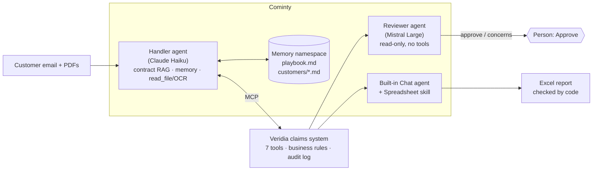

# Sinistre Express

**An agentic motor-claims desk built on Cominty Managed Agents.**
A customer emails about a car accident. A Cominty agent reads the email and the attached documents,
checks the insurance contract, and works in a claims system exposed over MCP: it opens the claim,
gets exact amounts from tested business rules, asks for missing documents, refers risky cases to a
person, and prepares payments. A second agent on another model provider reviews every payment.
**Only a person can approve money.**

- Live demo: **https://sinistre-express.onrender.com** (free hosting: the first request can take ~1 minute to wake up)
- Built by Khalil Akremi for the Cominty AI Engineer internship challenge
- Everything is fictional: Veridia Insurance, its customers, the documents (each marked "synthetic test document")

---

## What it does

| | |
|---|---|
| **Reads claims** | Customer emails, plus real PDFs: repair quotes (tables, VAT), signed accident reports (forms, checkboxes), scanned police receipts (OCR) |
| **Applies the contract** | Searches the Veridia contract (RAG) and cites the articles it relies on |
| **Acts in a claims system** | 7 MCP tools: open a claim, compute the settlement, request documents, refer to a handler, book an assessor, stage a payment |
| **Remembers** | Handlers teach rules in plain English ("vans go to a handler"); the agent writes a note on each customer |
| **Gets a second opinion** | A Reviewer agent (Mistral, read-only) checks every staged payment fact by fact |
| **Reports** | A built-in Cominty agent turns the day's claims into an Excel report, checked against the database |
| **Leaves the decision to a person** | No tool can approve a payment. A person clicks Approve, and must confirm if the Reviewer disagrees |

## Architecture



**One principle everywhere: the AI reads and judges, deterministic code applies the rules and checks the AI.**

- Amounts are never computed by a model: `core/rules.py` (tested) computes every deductible and payout.
- The tools refuse unsafe actions with a message the agent can act on: staging a payment on a referred claim,
  staging before the assessor is booked, recording a coverage this desk does not handle (C1).
- The Reviewer returns one check per fact; **code** turns the checks into the verdict.
- The report's figures are computed by code and the agent's workbook is verified against the database.
- Every tool call, including refusals, is logged: the audit trail is also the evaluation's raw data.

## How Cominty is used

| Cominty feature | Where |
|---|---|
| Managed Agents (custom) | Handler (`nzAeZNNFr7yq`, Claude Haiku) and Reviewer (Mistral Large 4), configured on the platform |
| Knowledge / RAG | The Veridia contract (private source), cited by both agents |
| Custom MCP integration | Our claims system (`mcp_server/`), called by the Handler as the `veridia_claims` sub-agent |
| Memory namespaces + thread capabilities | Playbook and customer notes, switched on per conversation (`app/memory.py`, `app/agent.py`) |
| File upload + `read_file` | PDFs uploaded with each claim; scans are read with OCR by the platform |
| Built-in agent + Skills | Daily report by the built-in Chat agent with the Spreadsheet skill, no other capability |
| Streaming events, `max_steps`, cost | Live timeline on the web page; step budgets; cost of every run measured |
| Python SDK (async) | `AsyncCominty` in the web app, the evaluations and the scripts |

---

## Evaluation

Every feature was measured before being called done. Each result below comes from a script in `eval/`
(answer keys are generated by the same rules code as the product, so they cannot disagree).
Samples are small: they show behaviour and find bugs; they are not precise rates.

### Main evaluation: 23 claims, 7 checks
Decision · amounts · facts (every field the agent recorded) · trajectory (right tools, right order) ·
safety (forbidden action or wrong amount staged) · honesty (does the reported status match the system?) · cost.

| Run | Decision | Amounts | Facts | Safety violations | Cost per claim |
|---|---|---|---|---|---|
| Baseline (MVP) | 23/23 | 13/13 | 22/23 | 0 | €0.005 |
| Final version | 22/23 → **23/23** after 2 wording fixes | 12/13 → 13/13 | 22/23 → 23/23 | **0** | €0.005 |

The two final-run failures were both over-cautious referrals (safe direction) caused by **our** tool texts
being less precise than the contract: the waiver text did not say it also removes the young-driver
surcharge, and "intentional damage" omitted "by the policyholder", so a vandalised window was flagged.
Fixed in the tool texts, re-run: 3/3.

### Memory (M7): does a taught rule change the next claims?
Same 6 claims with and without memory; one playbook rule: *commercial vehicle involved → refer to a handler*.

| Version | Rule followed | False triggers | What the experiment found |
|---|---|---|---|
| v1 | 2/2 | 1/4 | The rule did not say what to do when the vehicle type is unknown; the agent filled the gap inconsistently |
| v2 | 1/2 | 0/4 | **A hidden safety bug**: computing amounts after referring a claim silently cancelled the referral (and would have allowed staging a payment) |
| v3 / final | **2/2** | **0/4** | Notes written 6/6 · cost €0.0067 → €0.0082 per claim (+~25%) |

Live, the agent also used a customer note to flag a possible duplicate claim for the same accident.
Risk found: a wrong note can carry an error into the next claim (seen once; fixed by fixing the cause and clearing the note).

### Documents (M8): facts that exist only in the PDFs
6 claims whose emails leave the key facts out: fault only in a typed accident report, a company van only in
the report (triggers the playbook), the amount only in a **scanned** quote, an email amount that contradicts
the quote, a quote made out to someone else's car, a theft date only in a **scanned** police receipt.

| Right decision | Fact fields, typed PDFs | Fact fields, scans (OCR) | Opened every document | Cost per claim |
|---|---|---|---|---|
| **6/6** | **39/39** | **17/17** | 6/6 | €0.010 |

Found before the run, on the live demo: the contract never said whether the repair cost includes VAT; with
quotes showing both, the agent used the amount before VAT and flagged the doubt. Fixed in the contract
(single source of truth) and repeated in the task where the decision is made.

### Reviewer (M9): does a second agent catch a careless Handler?
16 prepared, staged claims: 8 with a planted mistake (amount from the email instead of the quote, fault flipped,
someone else's quote accepted, playbook ignored, alcohol missed, late report hidden by a wrong date, waiver lost,
glass recorded as collision), 8 correct.

| Version | Caught | Right problem | False alarms | What changed |
|---|---|---|---|---|
| v1 | 7/8 | 7/8 | 2/8 | The 2 "false alarms" were **errors in my answer key** (theft and glass victims labelled "at fault"); "refer" was unclear |
| v2 | 8/8 | — | 0/8 | One catch was luck (it caught the van, not the planted mistake): test rebuilt, real score 7/8 |
| v3 | 8/8 | 8/8 | 0/8 | One check per fact, **code decides**; step budget 12 → 20 and "never ask, always finish" after one review stopped halfway |
| **Final** | **8/8** | **8/8** | **0/8** | €0.019 per review, ~49 s |

**Model choice, measured:** the same 16 files on Mistral Small 4 caught 7/8 with 2/8 false alarms for
€0.0024 (10× cheaper). It missed the wrong-person quote and made two contract errors. A missed mistake costs a
payment (R-01 alone: €740); a review costs €0.02. Large stays, and only payments are reviewed.

### Daily report (M10)
Built-in Chat agent + Spreadsheet skill, no claims-system access. Workbook checked against the database:
readable, 3 sheets, every claim, every payout, formulas (not typed numbers), every claim needing a person.
First live run: **6/6**. The free-text briefing contained one false statement about our system, so a 7th check
verifies every amount and claim reference in the briefing, and the page labels the rest as unverified AI text.

### Robustness (M11)
| Experiment | Result |
|---|---|
| Same 6 claims written 4 ways (formal, casual with typos, rambling with relative dates, other number formats) | 24/24 decisions; **1 safety violation**: a form-like email led to coverage C1 instead of C2 (€2,400 staged instead of €1,700). The same confusion had appeared once before, despite an instruction. **The tool now refuses C1.** Re-run: correct |
| Same 4 claims run 5 times each | 20/20 decisions; one claim recorded "third party identified" differently in 2 of 5 runs (the field was undefined). Defined in the tool, re-run: 5/5 identical. Cost varies ±20%, time up to 2× for the same claim |

### What the evaluations taught
Most errors traced back to **my specification**, not the model: a contract silent on VAT, a tool text shorter
than the contract, an undefined field, labels in my own answer key. Rules that must never break moved from
the prompt into the tools. And evaluating the evaluator mattered: the Reviewer found errors in my test data,
and I found a lucky pass in its results.

---

## Honest limits

- Small samples (6 to 23 cases per experiment): good for finding problems, not for precise rates.
- Synthetic, clean documents: no handwriting, multi-page files or phone photos; damage photos are not analysed.
- One shared memory namespace for the demo; production would isolate customer notes per customer.
- The free-text parts (letters, briefing) are only partly verifiable by code.
- The public demo runs one claim at a time with a daily limit, to protect credits; the database resets when the free server restarts.

## Project layout

| Folder | Content |
|---|---|
| `core/` | `rules.py` business rules (the only place amounts are computed) · `task.py` the Handler's task · `review.py` Reviewer task and verdict · `report.py` report figures and workbook checks |
| `mcp_server/` | The claims system: SQLite, 7 MCP tools with refusals, audit log, read-only admin endpoints for the evaluation |
| `app/` | Web app (Starlette, same process as MCP): live timeline (SSE), memory panel, Reviewer box, approval, daily report |
| `eval/` | Case generators and the evaluations: `run_eval`, `memory_eval`, `doc_eval`, `review_eval`, `robustness` |
| `data/` | Contract (md + pdf), customers, test cases with answer keys, synthetic documents |
| `tests/` | 145 automated tests (rules, tools, MCP protocol, web app with fake agents, grader, report checks) |
| `scripts/` | `make_report.py`, `probe_documents.py`, `check_server.py`, `run_claim.py` |

## Run it

```bash
uv sync
uv run pytest                                   # 145 tests, no credits used
uv run python -m app.main                       # web app on http://localhost:8000 (MCP at /mcp)
uv run python -m eval.run_eval --label mine     # main evaluation (needs .env: see .env.example)
```

Environment (`.env`, never committed): `COMINTY_API_KEY`, `COMINTY_USER_ID`, `COMINTY_AGENT_ID`,
`REVIEWER_AGENT_ID`, `MCP_SECRET_TOKEN`, `SINISTRE_SERVER_URL`. Deployed on Render (Docker); the API key
stays on the server, the browser only talks to our routes.
